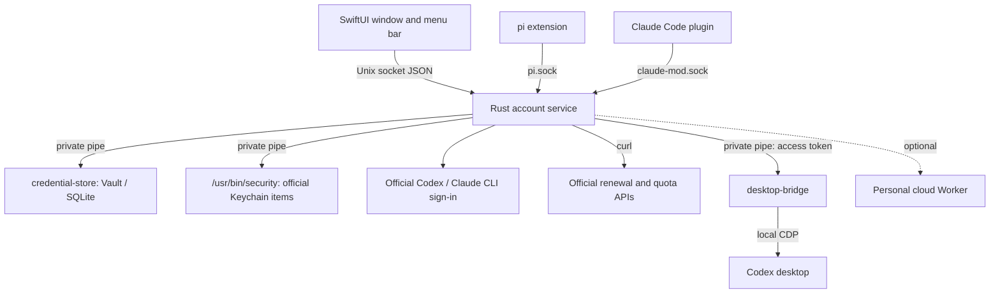

# AuthBaton

English | [简体中文](README.zh-CN.md)

A macOS menu-bar app that manages several Codex (ChatGPT) and Claude Code subscription accounts: sign-in, token renewal, quota and switching. You keep using the official clients; AuthBaton only handles the accounts and their credentials. When an account runs low, AuthBaton can use a reset or pass the baton to another account, so your work keeps going.

The interface is in Chinese. Free for personal, noncommercial use; companies need a commercial license.

> [!NOTE]
> AuthBaton was developed under the name AuthManager. The app bundle file (`AuthManager.app`), its data directory, the source folders and the integration names still use that name.

> [!IMPORTANT]
> This is an unofficial project, not affiliated with OpenAI or Anthropic. It relies on the official clients' local storage formats and undocumented interfaces, so it may stop working when they update. Check for yourself whether your use complies with each service's terms.

## Features

- **Accounts**: sign in new accounts in an isolated directory, take over the account you are already signed in to, or import an existing Codex `auth.json`. Make any account the official default sign-in.
- **Keeping sign-ins valid**: local checks, online authentication checks and automatic renewal per account. For the current Claude account, renewal follows the official lock protocol together with the CLI. If a renewal response is lost, AuthBaton reconciles automatically and never resends old credentials.
- **Quota**: every 5 minutes, a read-only query of the 5-hour and weekly windows, model windows, remaining resets and their expiry. Queries come faster when an account is close to empty.
- **Switching and resets**: each account has a low line and an order (reset first, switch first, reset only, switch only). When an account reaches its line, AuthBaton acts automatically and keeps a record. Off by default.
- **Codex desktop (experimental)**: connects to the official desktop app through a local debugging port and switches accounts without quitting it. Running sessions can be paused and continued after the switch.
- **Claude**: switches accounts without quitting the client; running sessions pick up the change within about 30 seconds. Optional 5-hour window warm-up: each day at a set hour, one Haiku message is sent through the official CLI. Off by default.
- **Integrations**: the pi extension takes access tokens per account. The Claude Code plugin reports quota, and a turn cut off by the quota limit resumes automatically after the switch.
- **Personal cloud (optional)**: a Worker deployed to your own Cloudflare account renews tokens centrally, so several devices share the same accounts. See [`cloud/`](cloud/README.md).

## Security boundaries

- Credentials exist only in AuthBaton's Keychain Vault, the storage the official clients need, and private pipes between processes. They are never written to SQLite, the UI's IPC or logs.
- There is one exception for command-line arguments. When an official Claude or Codex Keychain entry is larger than the 4096-byte single-line limit of `security -i`, it is passed to `/usr/bin/security` as a command-line argument instead. While that write runs, processes of the same macOS user can see the entry in the process list.
- With Codex desktop hot switching on, AuthBaton sets `CODEX_ELECTRON_DISABLE_QUIT_CONFIRMATION=1` in the login session environment (`launchctl setenv`) while it runs. It clears the variable when hot switching is turned off or AuthBaton quits. This keeps a desktop app opened from the Dock, or restarted after an update, from stopping at the quit confirmation when AuthBaton restarts it in debugging mode. A desktop app that AuthBaton opens itself gets `=0` and asks for confirmation on quit as usual. Before a restart, AuthBaton looks in the desktop app's own log (`~/Library/Logs/com.openai.codex/`) for the line that says the process has finished starting, and does not let it quit before then. It reads only that line and keeps nothing from the log.
- The UI process never gets credentials. The Rust service is the only source of account state, and IPC responses use a field allowlist.
- Apart from the warm-up you turn on for a Claude account, AuthBaton sends no model requests and never uses one as an authentication check.
- The runtime directory `~/Library/Application Support/AuthManager/` has mode 0700; sockets and the database are 0600. The desktop operation log `desktop-log.jsonl` (0600, rotated once it passes 512 KB) records only the time, the operation on the Codex desktop app, the account ID and a fixed reason. It contains no credentials. These measures protect against mistakes and credential leaks; they cannot defend against malicious programs running as the same macOS user.

## Architecture



| Path | Contents |
|---|---|
| `services/auth-service/` | Rust account service: account directory, renewal, quota, switching, automatic strategy, IPC |
| `macos/Sources/AuthManager/` | SwiftUI interface and menu bar |
| `macos/Sources/CredentialStore/` | Fixed-version Keychain Vault / SQLite component |
| `macos/Sources/DesktopBridge/` | Codex desktop connection helper and the scripts it injects into the page |
| `integrations/pi/` | pi extension and install script |
| `integrations/claude-code/` | Claude Code companion plugin |
| `cloud/` | Personal cloud Worker |
| `scripts/` | Build script, UI preview and interaction checks, synthetic tests |

## Build

Requirements:

- To run: macOS 14 or later.
- To build: Rust 1.89+ and the **macOS 26.5 SDK** from the Xcode Command Line Tools. `scripts/build.sh` pins this SDK because the 27.0 SDK declares the SwiftUI macros without shipping the macro plugin.
- To test: Node 22.6+.

```bash
cargo fetch --locked          # the build script builds offline, so fetch the dependencies first
bash scripts/build.sh         # writes dist/AuthManager.app (ad-hoc signed locally)
open dist/AuthManager.app
```

Set `AUTHMANAGER_BUILD_APP=<path>.app` to build somewhere else, so you do not overwrite the running app.

> [!WARNING]
> On first launch, the bundled `credential-store` is copied to `~/Library/Application Support/AuthManager/credential-store-v1`. The Keychain items in the Vault trust only this file's code signature. Do not delete or replace it, or the saved credentials can no longer be read.

## Tests

```bash
cargo test --locked --offline -- --test-threads=1      # must run serially: some tests share global state
cargo clippy --locked --offline --all-targets -- -D warnings
for t in scripts/test-desktop-*.ts scripts/test-automatic-*.ts; do node --experimental-strip-types "$t"; done
node --test cloud/test/*.test.ts
(cd integrations/pi && node --experimental-strip-types --test test-*.ts)   # needs pi installed globally
bash scripts/accounts-preview/render.sh interact        # builds the production UI against a synthetic service and drives interaction checks with OCR
```

Tests that need a real environment are skipped by default:

- `cargo test --locked --offline native_ -- --ignored --test-threads=1` needs the app built first, and reads and writes the system Keychain (synthetic accounts only).
- `scripts/claude-protocol/live-hot-switch.py` drives the real Claude CLI with an isolated `CLAUDE_CONFIG_DIR`.

## Integrations

- **pi**: `node --experimental-strip-types integrations/pi/install.ts` previews the changes; add `--install` to install the extension. Then run `/authmanager` in pi to refresh the account list, and choose the AuthManager Codex provider in `/model`.
- **Claude Code**: `bash integrations/claude-code/install.sh` copies the plugin into the app's data directory and prints that directory. In `~/.claude/settings.json`, set `CLAUDE_CODE_PLUGIN_DIRS` under `env` to that directory.
- **Personal cloud**: see [`cloud/README.md`](cloud/README.md).

## License

AuthBaton is released under the [PolyForm Noncommercial License 1.0.0](LICENSE.md).

- **Free to use**: by individuals, for noncommercial purposes such as learning, research and personal use; and by noncommercial organizations such as charities, educational institutions, public research organizations and government bodies.
- **Commercial license required**: for companies and other for-profit organizations (including employees using it for work), and for any other commercial use.

For a commercial license, contact [@WUXM5](https://github.com/WUXM5) on GitHub.
