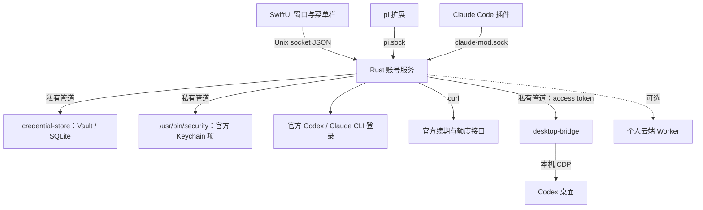

# AuthBaton

[English](README.md) | 简体中文

macOS 菜单栏应用，集中管理多个 Codex（ChatGPT）和 Claude Code 订阅账号：登录、续期、查额度、切换默认账号。你继续使用官方客户端，AuthBaton 只负责账号和凭据。账号快见底时，AuthBaton 可以用掉一次重置，或者把接力棒交给另一个账号，让工作接着进行。

> [!NOTE]
> AuthBaton 开发时叫 AuthManager。App 包的文件名（`AuthManager.app`）、数据目录、源码目录和各集成里的名字还沿用旧名。

> [!IMPORTANT]
> 这是非官方项目，与 OpenAI、Anthropic 没有关系。它依赖官方客户端的本地存储格式和未公开接口，官方更新后可能失效。是否符合各服务的使用条款，请你自行确认。

## 功能

- **账号**：在隔离目录登录新账号、纳管当前已登录的账号、导入现有 Codex `auth.json`；把任一账号切换为官方默认登录。
- **认证维护**：本地检查、联网认证检查、按账号自动续期。Claude 当前账号按官方锁协议与 CLI 协同续期；续期回应丢失时自动对账，不重发旧凭据。
- **额度**：每 5 分钟只读查询 5 小时 / 每周窗口、模型窗口、剩余重置次数和到期时间；快见底时加快查询。
- **换号与重置**：每个账号一条见底线和一种处理顺序（先重置、先换号、只重置、只换号），见底时自动处理，有执行记录。默认关闭。
- **Codex 桌面（实验）**：经本机调试端口连接官方桌面，不退出就能换号，可暂停并在换号后接续运行中的会话。
- **Claude**：不退出客户端换号（运行中的会话约 30 秒内生效）；可选的 5 小时窗口预热，每天定点用官方 CLI 发一条 Haiku 消息，默认关闭。
- **集成**：pi 扩展按账号取用 access token，并给 Codex 模型提供 Codex 自己的联网搜索（`web_run`）；Claude Code 配套插件上报额度，被额度打断的一轮在换号后自动续跑。
- **个人云端（可选）**：部署到你自己 Cloudflare 账户的 Worker 集中续期，多台设备共用同一批账号，见 [`cloud/`](cloud/README.zh-CN.md)。

## 安全边界

- 凭据只出现在 AuthBaton 的 Keychain Vault、官方客户端需要的存储位置和进程间私有管道里，不写入 SQLite、界面 IPC 或日志。
- 命令行参数只有一个例外：写入 Claude 或 Codex 官方 Keychain 条目时，如果内容超出 `security -i` 的 4096 字节单行上限，会改作 `/usr/bin/security` 的命令行参数传入。写入的那一刻，同一 macOS 用户下的进程能在进程列表里看到它。
- 开启 Codex 桌面热切换后，AuthBaton 运行期间会在登录会话环境里设置 `CODEX_ELECTRON_DISABLE_QUIT_CONFIRMATION=1`（`launchctl setenv`），关闭热切换或退出 AuthBaton 时清除。这样从 Dock 打开或更新后重启的桌面被自动以调试模式重启时，不会停在退出确认上；AuthBaton 自己打开的桌面传入 `=0`，退出时照常确认。重启前会在 Codex 桌面自己的日志（`~/Library/Logs/com.openai.codex/`）里查找该进程「启动完成」的那一行，启动完成前不会让它退出；只读这一行，不保存日志内容。
- 界面进程拿不到凭据；Rust 服务是账号状态的唯一来源，IPC 响应使用字段白名单。
- 除你为某个 Claude 账号开启的预热外，AuthBaton 不发起模型请求，也不用模型请求冒充认证检查。
- 运行目录 `~/Library/Application Support/AuthManager/` 权限 0700，socket 和数据库 0600。桌面操作记录 `desktop-log.jsonl`（0600，超过 512 KB 轮换一次）只记时间、对 Codex 桌面做的操作、账号 ID 和固定原因，不含凭据。保护对象是误操作和凭据外泄，不能防御同一 macOS 用户下的恶意程序。

## 架构



| 路径 | 内容 |
|---|---|
| `services/auth-service/` | Rust 账号服务：账号目录、续期、额度、切换、自动策略、IPC |
| `macos/Sources/AuthManager/` | SwiftUI 界面与菜单栏 |
| `macos/Sources/CredentialStore/` | 固定版本的 Keychain Vault / SQLite 组件 |
| `macos/Sources/DesktopBridge/` | Codex 桌面连接助手和注入页面的脚本 |
| `integrations/pi/` | pi 扩展与安装脚本 |
| `integrations/claude-code/` | Claude Code 配套插件 |
| `cloud/` | 个人云端 Worker |
| `scripts/` | 构建脚本、界面预览与交互检查、各类合成测试 |

## 安装

从 [Releases](https://github.com/WUXM5/AuthBaton/releases/latest) 下载 DMG，把 `AuthManager.app` 拖进「应用程序」。需要 Apple 芯片的 Mac，macOS 14 或更高。

App 只有 ad-hoc 签名，没有经过 Apple 公证，从网上下载后 macOS 会拦下它。第一次打开前，先去掉下载隔离标记：

```bash
xattr -dr com.apple.quarantine /Applications/AuthManager.app
```

## 构建

需要：

- 运行：macOS 14 或更高。
- 构建：Rust 1.89+；Xcode 命令行工具里的 **macOS 26.5 SDK**（`scripts/build.sh` 固定使用它，因为 27.0 SDK 声明了 SwiftUI 宏却没带宏插件）。
- 测试：Node 22.6+。

```bash
cargo fetch --locked          # 构建脚本离线构建，先拉取依赖
bash scripts/build.sh         # 输出 dist/AuthManager.app（本地 ad-hoc 签名）
open dist/AuthManager.app
```

设置 `AUTHMANAGER_BUILD_APP=<路径>.app` 可以输出到别处，避免覆盖正在运行的 App。

> [!WARNING]
> 首次启动会把内附的 `credential-store` 复制成 `~/Library/Application Support/AuthManager/credential-store-v1`，Vault 里的 Keychain 项只认这份文件的代码签名。不要删除或替换它，否则已保存的凭据将无法读取。

## 测试

```bash
cargo test --locked --offline -- --test-threads=1      # 必须串行：部分测试共用全局场景
cargo clippy --locked --offline --all-targets -- -D warnings
for t in scripts/test-desktop-*.ts scripts/test-automatic-*.ts; do node --experimental-strip-types "$t"; done
node --test cloud/test/*.test.ts
(cd integrations/pi && node --experimental-strip-types --test test-*.ts)   # 需要全局安装 pi
bash scripts/accounts-preview/render.sh interact        # 编译生产界面接合成服务，用 OCR 驱动交互检查
```

需要真实环境的测试默认跳过：`cargo test --locked --offline native_ -- --ignored --test-threads=1` 先要构建好 App，会读写系统 Keychain（只用合成账号）；`scripts/claude-protocol/live-hot-switch.py` 用隔离的 `CLAUDE_CONFIG_DIR` 驱动真实 Claude CLI。

## 集成

- **pi**：`node --experimental-strip-types integrations/pi/install.ts` 先预览改动，加 `--install` 才安装扩展。之后在 pi 里用 `/authmanager` 刷新账号列表，在 `/model` 里选择 AuthManager 的 Codex provider。
- **Claude Code**：`bash integrations/claude-code/install.sh` 会把插件复制到 App 的数据目录并打印该目录；在 `~/.claude/settings.json` 的 `env` 里把 `CLAUDE_CODE_PLUGIN_DIRS` 设为这个目录。
- **个人云端**：见 [`cloud/README.zh-CN.md`](cloud/README.zh-CN.md)。

## 许可

AuthBaton 按 [MIT License](LICENSE.md) 发布。
